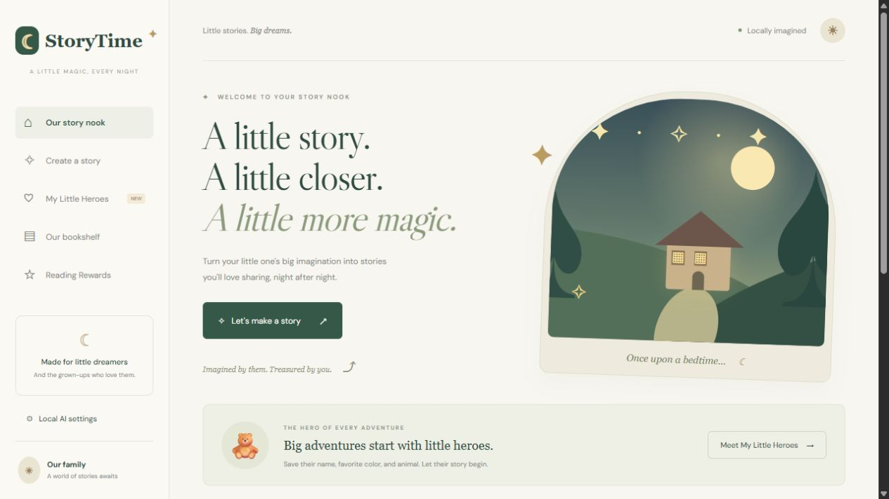

# StoryTime

**Little stories. Big dreams.** A cozy AI storytelling app for children and the grown-ups who read with them, powered by local models.

StoryTime turns a child's favorite character into personalized bedtime stories, interactive adventures, printable books, and narrated reading sessions. It uses **Ollama** for story text, **Automatic1111** for cover illustrations, and an optional **local Kokoro-compatible speech service** for AI narration.



## Features

| Feature | What it does |
| --- | --- |
| **My Little Heroes** | Save and edit a character's name, favorite color, and favorite animal. Include those preferences in future stories. |
| **Personalized stories** | Select a hero, theme, and optional idea to generate an original bedtime story with Ollama. |
| **Choose your own adventure** | Three chapters with two decision points, offering 2–3 choices each. Previous chapters and the selected choice shape the next chapter and ending. |
| **Illustrated covers** | Generate watercolor-style covers with the currently loaded Automatic1111 checkpoint. Retry failed illustrations without losing the story. |
| **Our bookshelf** | Reopen saved stories and continue unfinished adventures. |
| **Download as PDF** | Export an A5 book with cover artwork, paginated text, chapter headings, page numbers, and the selected adventure path. |
| **Listen to Story** | Hear gentle-paced narration with an installed device voice or optional local AI speech service. |
| **Reading Rewards** | Unlock stickers after 1, 5, and 10 different stories, and after exploring 3 themes. Each book earns completion credit once. |
| **Local AI settings** | Discover installed completion models and configure localhost service endpoints and voices. Cloud models are excluded from discovery. |

Themes include **Enchanted forest**, **Space explorers**, **Ocean wonders**, and **Magical kingdoms**.

## Technology

- **Frontend:** HTML, responsive CSS, and vanilla JavaScript.
- **Backend:** Node.js and Express, serving the app and proxying local AI requests.
- **Stories:** Ollama `/api/chat` with JSON output.
- **Illustrations:** Automatic1111 `/sdapi/v1/txt2img`.
- **Narration:** Browser Speech Synthesis or local `/v1/audio/speech`.
- **PDFs:** jsPDF, generated in the browser.
- **Storage:** Browser `localStorage`; no database or account required.
- **Tests:** Node.js test runner with mock local AI services.

## Quick start

Install Node.js 22 or newer and npm, then run:

```sh
git clone https://github.com/vams2krish/StoryTime.git
cd StoryTime
npm install
npm run dev
```

Open **http://127.0.0.1:4173**. Both `npm run dev` and `npm start` run the Express server. Restart it after server-side changes and refresh the browser after frontend changes.

To use another port in PowerShell:

```powershell
$env:PORT = "4180"
npm run dev
```

### Configure Ollama

Install [Ollama](https://ollama.com), start its local service, and download a story model:

```sh
ollama pull llama3.2
```

If Ollama is not already running through its desktop app, run `ollama serve`. The default model is `llama3.2:latest`. In **Local AI settings**, click **Find local models**, select a model, and save.

### Configure Automatic1111

Install [Stable Diffusion WebUI](https://github.com/AUTOMATIC1111/stable-diffusion-webui), load a checkpoint, and start it with `--api`.

For a standard Windows installation, add the flag to `webui-user.bat`:

```bat
set COMMANDLINE_ARGS=--api
```

Keep any existing flags and append `--api` if needed. The default address is `http://localhost:7860`. The app uses the currently loaded checkpoint and requests 512 × 640 cover images. Cover generation can be unchecked when creating a story.

### Configure narration

Device narration needs no separate speech server when the browser supports Speech Synthesis and has an installed voice. Choose a voice in the reader's **Reading voice** selector.

For AI narration, run a local Kokoro-compatible server accepting `POST /v1/audio/speech`. Enter its origin and voice ID in **Local AI settings**.

| Setting | Default / example |
| --- | --- |
| Ollama address | `http://localhost:11434` |
| Story model | `llama3.2:latest` |
| Automatic1111 address | `http://localhost:7860` |
| AI speech address | Empty by default; example: `http://localhost:8880` |
| AI speech model sent to service | `kokoro` |
| AI speech voice | `af_heart` |
| AI narration speed | `0.85` |

Ollama and Automatic1111 do not synthesize speech. A grandparent-like voice depends on the speech model or device voice installed; this repository does not ship a dedicated grandparent voice model.

## Your first adventure

1. Create a character in **My Little Heroes** with a name, favorite color, and favorite animal.
2. Select **Tell my story**, choose a theme, and optionally add an idea.
3. Enable **Choose your own adventure** for an interactive story, or leave it off for a complete bedtime tale.
4. Generate the story. If enabled, cover illustration runs after the text is saved.
5. Read together, listen, or download a PDF.
6. Follow adventure choices to the ending and select **We finished this story!** to earn reading credit.
7. Visit **Reading Rewards** to see unlocked stickers and progress.

## Project structure

```text
StoryTime/
├── public/
│   ├── index.html          # App shell
│   ├── app.js              # Heroes, stories, reader, rewards, narration, PDF
│   └── style.css           # Responsive design and decorative illustrations
├── server.mjs              # Express server and local AI proxies
├── tests/api.test.mjs      # API tests with mock services
├── docs/images/            # Project screenshots
├── package.json
└── README.md
```

## API overview

All app endpoints accept JSON via `POST`. Configured service origins must use `localhost`, `127.0.0.1`, or IPv6 loopback.

| Route | Purpose |
| --- | --- |
| `/api/models` | Discover local Ollama completion models. |
| `/api/story` | Generate a complete story or adventure chapter from hero, theme, history, and choice. |
| `/api/cover` | Request an illustration and return a PNG data URL. |
| `/api/speech` | Send text to a configured local speech service and return MP3 audio. |

## Tests and verification

```sh
npm test
```

Four automated API tests cover model filtering, hero preferences and adventure history, final chapter choices, localhost restrictions, and cover response formatting. These tests use mock services and need no downloaded models.

The initial implementation passed all four API tests, JavaScript syntax checks, and a browser check of profile creation. Live Ollama inference timed out while its model runner loaded. Automatic1111 was offline during initial verification. Full live story, image, speech, and PDF workflows still need end-to-end validation against running services; the automated tests do not certify those workflows.

## Storage, privacy, and current limitations

- Heroes, stories, covers, settings, and rewards are saved in this browser on this device. Clearing site data removes them. There is no account system or cross-device synchronization.
- Download PDFs to preserve books outside the browser. Large cover collections may fill browser storage.
- The server binds to `127.0.0.1`. This is a local development app without internet hosting, authentication, or multi-user configuration.
- AI requests go to configured loopback services. CSS also requests Google Fonts, with system-font fallbacks when unavailable.
- Prompts request gentle stories for ages 4–8, but model output is not guaranteed. Grown-ups should preview stories.
- Adventures are generated chapter by chapter; the saved book retains the chosen path rather than every possible branch.
- Unfinished adventure PDFs include only generated chapters and a continuation note.
- PDF export uses built-in fonts with limited Unicode coverage; Latin-script names and stories work best.
- Speed depends on model size, RAM/VRAM, and other workloads. Cold model loading can take several minutes.

## Troubleshooting

| Problem | What to check |
| --- | --- |
| No models found | Start Ollama, verify its address, and refresh models in Settings. |
| Generation times out | Try a smaller installed completion model, check Ollama logs, and allow it to finish loading. |
| Incomplete story response | Retry or use a model that follows JSON instructions reliably. |
| Cover unavailable | Start Automatic1111 with `--api` and a checkpoint loaded. Use **Illustrate this cover** to retry. |
| No narration | Check installed device voices or the configured speech endpoint and voice ID. |
| Port already in use | Choose another `PORT` and open its matching loopback address. |
| Saved data missing | Use the same browser and origin. Clearing site data or private browsing affects storage. |

## References

- [Ollama API](https://github.com/ollama/ollama/blob/main/docs/api.md)
- [Automatic1111 API](https://github.com/AUTOMATIC1111/stable-diffusion-webui/wiki/API)
- [jsPDF](https://github.com/parallax/jsPDF)

Built for little dreamers and the grown-ups who love them.
